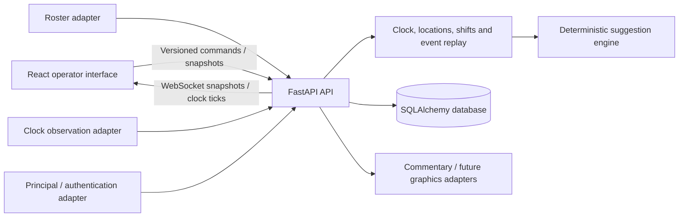

# Architecture

The live operator screen is a number-and-position control surface. Names, statistics, roster administration and the audit timeline stay in separate views. `frontend/src/useOperatorMode.ts` owns browser fullscreen synchronization and the focus-layout fallback. It changes only presentation: the same `useGame` hook, mounted team controls, selections, pending request and WebSocket remain in use in both modes. The host website receives an explicit `lightning-toi:operator-layout` event rather than being modified through parent CSS selectors; its contract is documented in `INTEGRATION.md`.

Lightning TV TOI is a standalone operator application. React and TypeScript render a two-team touch dashboard; FastAPI owns game state; SQLAlchemy and Alembic persist it in PostgreSQL (Docker) or SQLite (native development). The demo contains fictional teams and players. An optional server-side Hokejový Zápis integration imports specified external match/roster data; tracking itself has no external-service dependency. There are no AI services or undocumented Lightning TV API dependencies.

## Ownership and boundaries

| Module | Responsibility |
| --- | --- |
| `frontend/src` | Match setup, two-tap and group interactions, visible pending/error/reconnect state, clock interpolation |
| `backend/toi/domain.py` | Clock progression, validated commands, player-location invariants, shifts, statistics, correction and undo |
| `backend/toi/recommendations.py` | Rebuildable, explainable ranking from valid authoritative movements and configurations |
| `backend/toi/main.py` | HTTP/WebSocket transport, authorization, source checks and transaction coordination |
| `backend/toi/store.py` | Game persistence, permission checks, version comparison, idempotency and relational projections |
| `backend/toi/database.py`, `models.py` | SQLAlchemy sessions and database schema |
| `backend/toi/adapters.py` | Replaceable roster, authentication and clock contracts |
| `backend/toi/seed.py` | Fictional demonstration game; no tracking rules |
| `backend/toi/integrations/hokejovy_zapis` | Configured external client, roster-code parser and normalized match/roster provider |
| `backend/toi/import_service.py` | Preview fingerprints, transactional import and conservative source reconciliation |

## External roster import and reconciliation

The Hokejový Zápis client fetches only the configured provider's documented match-information endpoint, with validated positive Game IDs, bounded network behavior and an expiring preview cache. Its normalizer maps raw source JSON into a stable DTO. The application service converts that DTO into local game state inside one transaction; the shift and recommendation engines do not parse external roster JSON.

Migration `0002` adds a persistent provider-person identity table, nullable player-to-person mapping, and match-roster source identity/provenance fields. Existing game, player and shift identifiers are retained. A player's engine identity remains its match-specific roster entry; the persistent person mapping recognizes that same external player across matches without merging historical game-roster records.

External persistent player IDs, match-roster IDs, team IDs and Game IDs retain provider namespaces. Source lineup codes are assignment metadata, never identities. Source snapshots and import baselines are stored separately from operator-edited fields. The official `startingSix` flag proposes initial player locations, while the structured three-digit roster code supplies role and line/pair assignments. A mid-game import starts a fresh effective playing-time axis at the declared coverage point, without fabricating earlier shifts.

Repeated import reopens an existing session. Refresh first returns a source diff and fingerprint, then requires explicit confirmation against the current local version. Reconciliation preserves active locations, clocks, shifts, movement history and learned observations. Genuinely new players start on the bench; removed source players remain flagged so historical IDs stay valid. Metadata changes follow a three-way comparison against the prior source baseline, protecting local edits. Operator lines remain unchanged unless restoring imported lines is explicitly requested.

## Clock model

All timing uses integer milliseconds. `remaining_ms` is a conventional period countdown, while `playing_ms` is a monotonic effective playing-time coordinate used by shifts. Wall time advances this coordinate only when the authoritative clock runs, and progression is capped at the remaining period time. A stopped clock adds no playing time, however long the operator waits.

A clock correction reanchors the displayed countdown without rewriting time already credited to players. It therefore cannot produce negative shift durations or double-count earlier time. This deliberate prototype policy is auditable and avoids pretending a late scoreboard correction reveals exactly how long each earlier player was on the ice. Period configuration is independent of regulation defaults; period changes preserve per-period totals.

The browser interpolates the latest authoritative clock locally for a smooth display. It does not write time or shifts independently. Periodic compact clock/TOI ticks reanchor the display, and refresh/reconnect fetches current state.

## Movements and history

Every eligible rostered player has exactly one physical location: `ON_ICE`, `BENCH` or `PENALTY_BOX`. Each on-ice player has one open shift. A movement off the ice closes that shift; entering the ice opens another. Group changes share one event and one timestamp and commit atomically. Unequal or unusual skating combinations produce warnings rather than an enforced six-player constraint. A penalty-box location is never interpreted as a formal manpower penalty.

Player and team identifiers are opaque; jersey numbers are match roster attributes. External identifiers are optional mapping fields. Initial locations and active movement events can reconstruct locations and shifts. Undo and corrections deactivate or replace authoritative movements while preserving an audit record; recommendation observations follow the corrected history.

The database holds a versioned authoritative game aggregate as JSON plus relational projections for teams, players, game rosters, locations, shifts, lines and match events. Separate audit and request-receipt records preserve command identity and retries. This bounded match aggregate makes replay and atomic corrections straightforward. It duplicates some data intentionally; integrations should consume the API rather than treating projection rows as a second write model.

Statistics separate completed from active shifts. Average completed-shift length and completed-shift count exclude an open shift. Power-play, penalty-kill and even-strength totals remain unavailable until an authoritative playing-strength timeline is integrated.

## Transactions and concurrent clients

The server is authoritative. Commands include a unique `request_id` and `expected_version`. A duplicate request is replayed idempotently; conflicting stale versions return HTTP 409. The UI fetches the latest snapshot and asks the operator to make the selection again. Player movements, shifts, events, projections and the version change share a database transaction.

WebSockets carry full snapshots for the initial connection and persisted mutations. Idle `clock.tick` messages carry only the clock, player TOI fields, warnings and current skater counts, keeping growing event and shift histories out of periodic traffic. Clients merge equal-version ticks into their existing snapshot, discard lower versions and fetch fresh state if a tick reports a newer version. Database concurrency controls protect multiple operator clients. Run **one backend worker**: the current notification hub is process-local. Before adding workers or replicas, replace it with PostgreSQL notifications or Redis pub/sub and preserve transactional ordering.

## Deployment and trade-offs

Docker Compose runs PostgreSQL, a single FastAPI worker and nginx serving a compiled frontend. Nginx forwards `/api/` and WebSocket upgrades to the API. Native development uses the same domain and API with SQLite by default. Alembic owns schema upgrades; existing database files or volumes must be backed up before future migrations.

This is a production-oriented prototype, not a claim of production hardening. A real deployment needs TLS, existing website identity, secrets management, database backup/restore, operational monitoring and an agreed external data-ownership model. Formal penalty rules, seasonal aggregates, direct vMix output and a real OCR pipeline are extension work. The recommendation engine works deterministically without external services and exposes reasons rather than calibrated probabilities.
