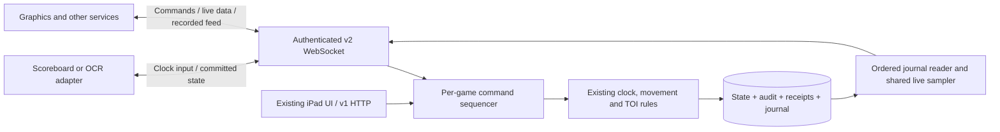
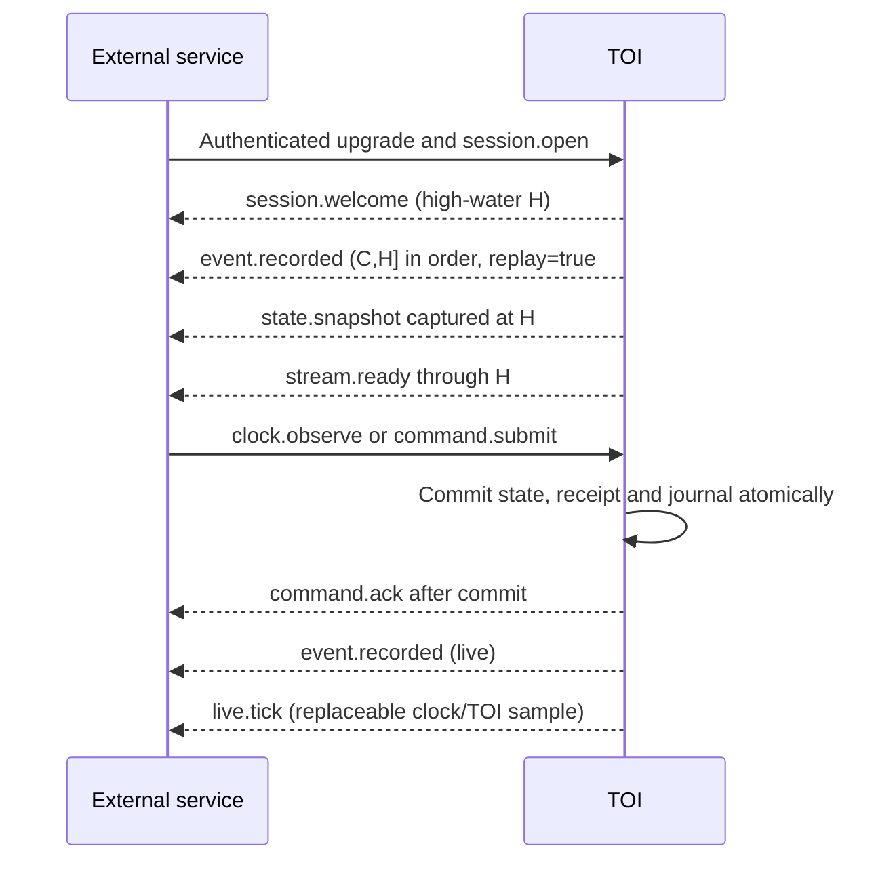

# External service interface: clock, player TOI and recorded changes

**Status: implemented in release 2.0.0.** The v2 service API is additive: the existing iPad interface and v1 endpoints remain supported. Enable `TOI_STREAM_ENABLED=true` and configure scoped `TOI_SERVICE_TOKENS` to use it. The [release/update guide](UPDATING.md) explains deployment of the prebuilt images. Sections 1–2 inventory the legacy v1 integration; sections 3 onward define v2. Latency/capacity numbers in section 13 remain acceptance targets unless a measured result is explicitly identified in [VALIDATION.md](VALIDATION.md).

The requirement is a sustained two-way connection for an authoritative clock service, individual player TOI, the current on-ice players and their times, and an updating feed of everything recorded for a match. The design separates live calculated values from durable recorded changes so that neither is mistaken for the other.

## Contents

1. [What exists now](#1-what-exists-now)
2. [Connect to the existing application](#2-connect-to-the-existing-application)
3. [V2 architecture and ownership](#3-v2-architecture-and-ownership)
4. [Endpoints and transport](#4-endpoints-and-transport)
5. [Messages and connection lifecycle](#5-messages-and-connection-lifecycle)
6. [Live player and lineup data](#6-live-player-and-lineup-data)
7. [Authoritative clock connection](#7-authoritative-clock-connection)
8. [Commands and acknowledgements](#8-commands-and-acknowledgements)
9. [Recorded feed, replay and recovery](#9-recorded-feed-replay-and-recovery)
10. [Flow control and failures](#10-flow-control-and-failures)
11. [Authentication and permissions](#11-authentication-and-permissions)
12. [Deployment and configuration](#12-deployment-and-configuration)
13. [Latency, capacity and observability](#13-latency-capacity-and-observability)
14. [Implementation and acceptance plan](#14-implementation-and-acceptance-plan)
15. [Contract files and references](#15-contract-files-and-references)

## 1. What exists now

The application already supports two-way integration using **HTTP commands into TOI and a persistent WebSocket stream out**. Its existing WebSocket does not receive application commands. Other services initiate connections to TOI; TOI does not currently dial an external service or provide a vMix/scoreboard-specific driver.

Through the Portainer frontend, use the same host/port as the dashboard, for example `http://192.168.1.50:8080`. The backend and database do not need published host ports.

| Available interface | Purpose |
| --- | --- |
| `GET /api/v1/games` | Discover match IDs and versions |
| `GET /api/v1/games/{id}/state` | Complete match state, all players, clock, locations, TOI, events and shifts |
| `GET /api/v1/games/{id}/statistics` | Individual player totals, current shift, completed-shift statistics and period totals |
| `GET /api/v1/games/{id}/locations` | Current physical location and eligibility of each player |
| `GET /api/v1/games/{id}/clock` | Current authoritative clock |
| `GET /api/v1/games/{id}/events` | Recorded match events, including inactive/undone history |
| `GET /api/v1/games/{id}/shifts` | Shifts; optionally filter by `player_id` |
| `GET /api/v1/games/{id}/audit` | Command audit, identities and before/after values |
| `POST /api/v1/games/{id}/actions` | Movements, substitutions, clock control, setup, undo and corrections |
| `POST /api/v1/games/{id}/clock/observations` | Timestamped external authoritative clock input |
| `WS /api/v1/games/{id}/ws` | Initial/full mutation snapshots and compact idle clock/TOI ticks |
| `/health`, `/docs`, `/openapi.json` | Health and generated HTTP contract |

[API.md](API.md) contains the complete existing resource and payload reference. [INTEGRATION.md](INTEGRATION.md) covers website mounting and roster-provider imports.

Limitations of the legacy v1 stream (addressed by the separate v2 service interface below):

- WebSocket updates are not a durable journal. Slow clients can receive a replacement snapshot; disconnected clients can miss individual notifications.
- Idle clock ticks arrive after approximately one second without a mutation, rather than on a guaranteed periodic schedule.
- There is no WebSocket command acknowledgement, replay cursor, per-service read-only role or per-game read allowlist.
- Authentication is checked when opening a socket; existing sockets do not have a documented token-expiry/reauthentication contract.
- Run one backend worker. Its notification hub is process-local.
- No latency or sustained-capacity benchmark has been established. The running application must not be described as already meeting the targets in this design.

Source of truth for this inventory: `backend/toi/main.py`, `schemas.py`, `adapters.py`, `store.py` and `models.py`. This document does not assert that the user's Portainer deployment is healthy; the earlier frontend restart problem still needs runtime confirmation.

## 2. Connect to the existing application

### Authentication and discovery

Use `Authorization: Bearer <token>` with HTTP. A native WebSocket client can send the same header. The browser UI supports a query token, but new service clients should use headers so credentials are not placed in URLs. Use TLS for service credentials across shared networks.

```bash
export TOI_BASE_URL='http://192.168.1.50:8080'
export TOI_TOKEN='YOUR-CONFIGURED-TOKEN'
curl --fail --silent --show-error \
  -H "Authorization: Bearer $TOI_TOKEN" \
  "$TOI_BASE_URL/api/v1/games"
```

Use the returned game ID. A provider match `966` normally maps to `hz-966`; a local demonstration match is `demo`. Identify players by their opaque `id`, not jersey number or name.

### Read the current live feed

For example, a Python service using the application's existing `websockets` dependency can connect as follows. This is v1 code, usable with the current backend; the v2 examples later use the separate service protocol.

```python
import json
import os
from urllib.parse import quote, urlsplit, urlunsplit
from websockets.sync.client import connect

base = urlsplit(os.environ["TOI_BASE_URL"])
game_id = quote(os.environ.get("TOI_GAME_ID", "demo"), safe="")
url = urlunsplit(("wss" if base.scheme == "https" else "ws",
                 base.netloc, f"/api/v1/games/{game_id}/ws", "", ""))
headers = {"Authorization": f"Bearer {os.environ['TOI_TOKEN']}"}

with connect(url, additional_headers=headers) as socket:
    for raw in socket:
        event = json.loads(raw)
        if "state" in event:
            state = event["state"]
            on_ice = [p for p in state["players"] if p["location"] == "ON_ICE"]
            print("lineup", state["version"], on_ice)
        elif event["type"] == "clock.tick":
            print("clock", event["clock"], "player TOI", event["toi"])
```

This observation example deliberately omits a production consumer's reconnect loop and durable processing. For a v1 cache: keep the latest state version, discard older snapshots/ticks, merge equal-version ticks by player ID, and fetch `/state` if a tick has a higher version. Do not replace a newer cache with an old idempotent HTTP receipt. On disconnect mark output stale and reconnect with bounded exponential backoff; fetch the current state. This recovers current data, not every missed record.

### Supply the clock through legacy v1

Set `TOI_CLOCK_SOURCE` to the exact provider name, for example `scoreboard-a`, and restart/redeploy the backend with that setting. Its default is `manual`. Submit the following shape to `POST /api/v1/games/{id}/clock/observations`, using a supervisor credential:

```json
{
  "request_id": "104a3ee5-e76b-4547-85b0-cd981c8df132",
  "expected_version": 12,
  "period": 2,
  "remaining_ms": 734000,
  "running": true,
  "observed_at_ms": 1792180800000,
  "source": "scoreboard-a"
}
```

Values are examples: supply the actual clock reading, current version and UTC observation time. Observations must have strictly increasing timestamps. The existing default age limit is `TOI_CLOCK_STALE_MS=10000`; timestamps more than 2,000 ms into the future are rejected. Clock input corrects the displayed countdown without retrospectively inventing missed playing time. Retry an unknown HTTP outcome with the identical request ID and body, including its original version.

Persist observations at approximately 1 Hz plus immediate start/pause/period transitions. Debounce noisy OCR and coalesce display-identical raw samples in the clock adapter. Do not send video-frame-rate OCR directly to this endpoint: each current observation rewrites match projections and saves a full growing response receipt. Over a long match, receipt storage can grow quadratically with the number of observations.

Non-activated v1 manual takeover has no fence: a later valid configured-source observation can take control again. Pause a legacy clock bridge during deliberate manual control. Activating v2 creates a journal baseline and fences old external feeds: it caps their credited time at the saved stale deadline, pauses them, and requires explicit reassignment using the v2 ownership controls. Legacy unfenced observations are rejected for activated games.

## 3. V2 architecture and ownership

TOI remains authoritative for player locations, shifts, game playing time, TOI calculations, corrections and recommendation learning. A configured clock source supplies clock observations. Consumers render or transform TOI data; they do not write calculated player times back into the database.



There are two distinct outputs:

| Output | Content | Delivery |
| --- | --- | --- |
| Recorded feed | Every committed domain/configuration/clock change, including undo/correction and roster reconciliation | Durable, ordered, replayable; at-least-once delivery |
| Live feed | Current clock and calculated TOI for every player, plus current on-ice IDs | Replaceable periodic samples; latest value is useful |

An elapsed millisecond is not a database event. Running clock/TOI samples can change without a committed state version changing. Every accepted clock observation and control transition is recorded; raw rejected OCR samples are not match records. Rejected commands go to operational logs/metrics rather than the successful-change journal.

The core does not send arbitrary executable instructions to other services. It sends state and recorded facts over the same duplex connection. If another service needs its own remote command vocabulary, implement that in a named adapter with its own acknowledgement contract; do not overload a TOI event as an instruction or echo incoming clock values back as new observations.

## 4. Endpoints and transport

**These v2 paths are implemented in the 2.0.0 backend.** HTTP routes return 404 while streaming is disabled; enabled routes require a scoped service credential. Existing pre-v2 images do not gain these endpoints by changing Compose alone.

| Endpoint | Contract |
| --- | --- |
| `WS /api/v2/games/{game_id}/stream` | One sustained two-way connection per match and service |
| `GET /api/v2/games/{game_id}/live` | `{baseline_cursor, sampled_at_ms, state}` using the live state described below |
| `GET /api/v2/games/{game_id}/players/{player_id}/toi` | `{game_id, version, baseline_cursor, sampled_at_ms, player}` for one roster identity |
| `GET /api/v2/games/{game_id}/on-ice` | Same envelope with `home` and `away` arrays of full live player records |
| `GET /api/v2/games/{game_id}/journal?after=C&through=H&limit=100` | Stable, ordered journal page: `{records,next_cursor,through_cursor,has_more}` |

The REST read projections and WebSocket samples use the same authoritative computation/cache. They cannot establish separate timing or recommendation engines. Existing v1 endpoints remain the HTTP command and history fallback.

Use ordinary RFC 6455 WebSockets, UTF-8 JSON text messages, and subprotocol **`lightning.toi.stream.v2`**. This is not Socket.IO. Services use `wss://HOST/api/v2/games/ID/stream` through the same nginx frontend. The handshake must request the subprotocol and provide an Authorization bearer header. Reject a missing/unsupported protocol before accepting the connection. Native service clients can omit `Origin`; a supplied browser origin must be explicitly allowed.

One connection addresses one game. A service following multiple games opens one connection per game. The initial version has no dynamic topic/filter language: authorized consumers receive the entire match's public live projection and journal. Team restrictions limit writes, not partial read projections.

Message bodies, identifiers, times and errors are defined by [the JSON Schema](docs/interfaces/service-stream-v2.schema.json). Its client/server root definitions also establish message direction. Examples are in [examples.json](docs/interfaces/examples.json). Runtime wire admission reuses the existing Pydantic action models; no JSON Schema validator is added to production dependencies.

## 5. Messages and connection lifecycle

### Common envelope

Every application message has `protocol: 2`, `type`, a new UUID `message_id`, `game_id` matching the URL and `data`. Server messages additionally contain UUID `connection_id`, UUID `server_epoch`, integer `seq >= 1` and UTC integer `server_time_ms`. There are no credentials in message bodies.

| Coordinate | Meaning |
| --- | --- |
| `message_id` | One transport message; new for a retry envelope |
| `request_id` | One intentional command; unchanged across identical retries |
| `seq` | Consecutive server frames on this connection, starting at 1; includes ACKs, errors and samples |
| `version` | Durable match mutation version; unchanged by display ticks |
| `journal_generation` | Durable UUID identifying this journal timeline; survives backend restart |
| `journal_seq` | Strictly increasing durable record number within game/generation |
| `cursor` | Opaque game/generation/sequence checkpoint; clients must not construct it |
| `server_epoch` | New UUID after backend-process restart; unrelated to journal history |
| `sample_seq` | Increasing per-game live-projection sample counter within one server epoch; not a durable checkpoint |

Keep JSON integer counters and times within the interoperable range `0..9007199254740991`; rotate a journal generation before exhaustion. New protocol fields are bounded in the schema; check nested legacy payload integers at the wire-validation boundary as well, without changing the existing v1 payload definitions. Reject duplicate JSON keys, non-finite numbers, invalid UTF-8 and binary application messages before dispatch. Treat IDs and cursors as strings. UTC clocks help diagnostics; order records by journal sequence, never by wall timestamps. Use a monotonic local timer for deadlines and display interpolation.

### Opening

Send `session.open` within five seconds after handshake:

```json
{
  "protocol": 2,
  "type": "session.open",
  "message_id": "a89f3c2e-76ef-4f40-93bd-49d89d57023f",
  "game_id": "demo",
  "data": {
    "client_id": "graphics-primary",
    "journal_mode": "resume",
    "after_cursor": "opaque-previously-processed-cursor",
    "tick_hz": 5
  }
}
```

`client_id` is a diagnostic label, not identity or authorization. `tick_hz` is one of `0,1,2,5,10`; zero disables periodic live samples, not recorded changes. The server advertises the accepted limits in `session.welcome` and must reject unsupported requests rather than silently change meaning.

Choose exactly one journal mode:

- `now`: explicitly accept a current-state baseline and future records; skip older records by choice. Omit `after_cursor`.
- `beginning`: receive all retained records from the earliest valid resume position. Omit `after_cursor`.
- `resume`: require the exact last successfully processed cursor. A missing/invalid/expired cursor is an error, not permission to skip history.

`session.welcome` includes the client label, granted permissions, durable journal generation, oldest valid resume cursor, captured high-water cursor, selected `tick_hz`, credential expiry, `connection_expires_at_ms`, `journal_retention_days`, heartbeat/message/in-flight limits, `queue_max_messages`, `queue_max_bytes`, `send_timeout_ms` and `rate_limits`. `auth_expires_at_ms` can be null only for a static token; `connection_expires_at_ms` is always present and at most one hour after connection establishment or the credential's expiry, whichever comes first. The rate-limit object specifies command and clock-observation sustained/burst ceilings with the names in the schema.

### Bootstrap barrier

Register the connection and capture a snapshot plus journal high-water **H** under the same per-game sequencing boundary used by every writer. Queue subsequent records greater than H. Send:



ACK and event arrival order after a command is not guaranteed; each is independently meaningful. Historical replay always precedes the bootstrap snapshot and `stream.ready`. Reject new mutations before `stream.ready` with `SESSION_NOT_READY`. Do not assume that accepting a TCP/WebSocket connection makes it ready to write.

If initial replay exceeds 1,000 records or 8 MiB of encoded record data, send `replay.required` with the fixed target H, unsubscribe and close with 1013. Page the REST journal through H, durably process it, then reconnect from the last processed cursor. Do not keep an unbounded socket backlog while catching up over REST. A fresh or caught-up connection receives the initial snapshot without replay work.

### Message catalogue

| Type | Direction | Meaning |
| --- | --- | --- |
| `session.open` | Service → TOI | Choose resume policy and sample rate |
| `session.welcome` | TOI → service | Identity scope, journal bounds, limits and heartbeat settings |
| `state.snapshot` | TOI → service | Authoritative live projection and state-baseline cursor |
| `state.request` | Service → TOI | Request another current snapshot; empty `data` |
| `stream.ready` | TOI → service | Bootstrap replay/snapshot complete through its cursor |
| `command.submit` | Service → TOI | A versioned mutation |
| `clock.observe` | Service → TOI | Fenced authoritative clock observation |
| `command.ack` | TOI → service | Durable command outcome; includes duplicate indicator |
| `command.error` | TOI → service | Structured rejection or explicit unknown outcome |
| `event.recorded` | TOI → service | One committed journal batch, live or replayed |
| `live.tick` | TOI → service | Calculated clock, per-player times and on-ice IDs |
| `replay.required` | TOI → service | Backlog requires bounded REST catch-up |
| `session.error` | TOI → service | Connection/bootstrap error; normally followed by close |
| `ping`, `pong` | Either direction | Application heartbeat / round-trip measurement |

## 6. Live player and lineup data

A `state.snapshot.data` contains `{reason,baseline_cursor,version,state}`. `state` contains `version`, `sampled_at_ms`, `sample_seq`, `game`, `teams`, `players`, `lines`, `clock`, `clock_authority`, `on_ice`, `warnings` and `strengths`. Histories are omitted to keep the live projection bounded by roster/configuration size; retrieve history through v1 or the journal. `sampled_at_ms` is the UTC instant of calculation; `sample_seq` orders calculations within a server epoch without relying on a wall clock staying monotonic.

Every live player contains:

| Field | Meaning |
| --- | --- |
| `id`, `team_id` | Stable match roster and team identities |
| `name`, `number`, `position`, `eligible` | Display/eligibility metadata; jersey number is not identity |
| `location` | `ON_ICE`, `BENCH` or `PENALTY_BOX` |
| `total_toi_ms` | Completed and currently active on-ice playing time |
| `current_shift_ms` | Current active shift duration; zero when off ice |
| `completed_shifts` | Count excluding an open shift |
| `average_shift_ms`, `longest_shift_ms` | Existing domain statistics; average excludes the open shift |
| `toi_by_period` | Period-number string → milliseconds |

Existing optional external identity, role and provenance fields can also appear. `on_ice.home` and `on_ice.away` are arrays of player IDs, derived atomically from this same state; join them to `players` to obtain each current player's individual times. Do not assume six players, equal team sizes, a goalkeeper, or jersey uniqueness across both teams.

`live.tick.data` has `version`, `sampled_at_ms`, `sample_seq`, `clock`, `clock_authority`, `toi`, `on_ice`, `warnings` and `strengths`. `toi` contains `player_id` plus the timing/statistics fields above for **all rostered players**, including players on the bench and in the penalty box. `clock` includes `period`, `remaining_ms`, `running`, `playing_ms` and `anchor_unix_ms`. Integer `_ms` values are milliseconds; `playing_ms` is accumulated effective playing time, not UTC. Each tick carries the current authority/freshness fields even if a database outage delays persistence of a stale transition.

Rules for consumers:

1. Bootstrap/reconnect from the snapshot after replay. Replay handlers process historical facts without repeatedly replacing a current graphics display with old lineups.
2. Live `event.recorded.record.live_state` provides the state following that commit. Apply it only when newer than the displayed durable version. It also updates roster, lineup and authority metadata.
3. Merge equal-version live ticks by player ID; discard lower-version ticks. A higher-version tick without its preceding record is a consistency fault: stop issuing dependent commands and resynchronize/replay.
4. A single ordered sender must publish each committed record before a tick based on that revision. For equal versions, reject a sample with a lower `sample_seq` within the same server epoch. The shared sampler allocates that counter for each newly calculated projection; all subscribers can receive the same sample. Reinitialize the sample baseline after a new epoch's bootstrap. Historical journal samples retain their original counters and must not be compared with the current epoch's live counter. ACKs never replace subscribed state.
5. Interpolate a running clock/active shift locally between samples, bounded at period end and the authoritative feed's stale deadline. Reanchor from each new authoritative sample. Stop interpolation when disconnected or stale; never write interpolated TOI back.

At default 5 Hz, periodic samples can be approximately 200 ms apart; use 10 Hz where a consumer needs 100 ms sample spacing. Committed transitions are pushed immediately. Smooth visual animation uses local interpolation rather than database writes at video frame rate.

Formal power-play/penalty-kill/even-strength TOI remains unavailable. Physical skater counts and penalty-box locations must not be relabeled as authoritative strength classifications.

## 7. Authoritative clock connection

The connection carries clock input in one direction and accepted clock/player state back in the other. It does not change the existing TOI clock-correction policy: a revised countdown does not retroactively rewrite credited playing time.

### Explicit ownership and fencing

Persist `clock_authority` with:

```json
{
  "mode": "external",
  "generation": 4,
  "source": "scoreboard-a",
  "service_id": "clock-bridge-a",
  "last_source_sequence": 812,
  "feed_status": "fresh",
  "observed_at_ms": 1792180800000,
  "stale_at_ms": 1792180803000
}
```

A supervisor uses `command.submit` with command type `clock.authority.set` and payload `{mode,source,service_id}`. `mode` is `manual` or `external`; source/service ID are null for manual and nonempty for external. Every accepted ownership change increments the fencing generation and resets source sequence to zero. Ownership changes pause the clock; a fresh accepted observation decides whether external running resumes. Do not carry an old provider's running state into a new ownership generation.

`observed_at_ms` and `stale_at_ms` are nullable: both are null in manual mode and before the first external observation. An external owner without a fresh observation has `feed_status: "stale"`. Otherwise `stale_at_ms` is the accepted observation time plus the configured timeout. Consumers stop extrapolating at that deadline even before a persisted watchdog event arrives.

Manual v1 clock commands must also fence the previous service owner when this feature is activated for a game. Pause, set, advance and start through the operator interface therefore place that game in manual mode. Fresh packets from the old generation cannot take it back. A supervisor explicitly returns authority to the external provider.

Only the named authenticated service/source can submit for that generation. On service restart read the current generation/last source sequence and continue above it. Keep both in the bridge's durable outbound checkpoint. A newer generation invalidates pending old-generation writes, except that an already committed identical request can still return its original outcome.

For activated games, persisted per-game `clock_authority` is the source of truth. Global `TOI_CLOCK_SOURCE` and its existing legacy gates apply only to non-activated games; they must not override a fenced game's owner. The implementation must route both command and read/watchdog calculations through this distinction.

The existing v1 `/clock/observations` payload has no fencing fields. For an activated fenced game it must return a documented conflict requiring an upgraded adapter; automatically assigning it the current generation would bypass the fence. Non-activated games retain v1 behavior. This compatibility gate must be implemented before enabling the new clock service.

### Observation example

```json
{
  "protocol": 2,
  "type": "clock.observe",
  "message_id": "88d33d58-7beb-4d96-9e1f-7fb30a3e8e12",
  "game_id": "demo",
  "data": {
    "request_id": "1488e6ea-55c3-4ea2-8fce-51e4da531f2c",
    "expected_version": 42,
    "authority_generation": 4,
    "source": "scoreboard-a",
    "source_sequence": 813,
    "observed_at_ms": 1792180800000,
    "period": 2,
    "remaining_ms": 734000,
    "running": true
  }
}
```

Validate the authorized service/source/generation, increasing source sequence and observation UTC time, configured period/countdown, and expected version before new application. Duplicate receipt lookup follows current authentication/scope checks but precedes new-write ownership/version checks, so a committed retry can report its old outcome after a manual takeover without reapplying it.

The bridge should send 1 Hz observations plus immediate transitions. All accepted observations are journaled. Limit sustained clock writes to 2/s, with a small burst of 5 for transitions; reject excess input, do not create an unbounded input queue. A continuously uncertain/contradictory OCR reading should be exposed as adapter status and should not start the official clock.

Use NTP-synchronized hosts. Preserve the existing 2,000 ms maximum future tolerance; fenced-clock staleness defaults to 3,000 ms at a 1 Hz feed. Age is measured from `observed_at_ms`, not an adapter's resend time. Do not resend an old reading with a fabricated newer observation timestamp.

A scheduled watchdog must recheck the latest authority generation/observation transactionally and persist a single `clock.feed.stale` record when that generation's deadline passes. Clamp credited playing time at the observation's stale cutoff; do not credit the wait for the watchdog task. No new owner is granted by a timeout. A fresh observation may resume only while the same external owner/generation is still active. Once manual takeover occurs, an old feed cannot resume it.

The current computed stale projection does not itself persist a new event/version. V2 adds a scheduled watchdog and a durable stale record; non-activated v1 retains its original computed projection. If a database outage prevents the watchdog commit, live output still marks the feed stale and stops interpolation; persistence resumes with the original cutoff once the database recovers.

## 8. Commands and acknowledgements

`command.submit.data` is `{request_id,expected_version,command:{type,payload}}`. Map the existing six command types directly to the same Pydantic/domain validation used by v1. Do not implement another movement, ranking or time-calculation engine in an adapter. Add `clock.authority.set` as the explicit ownership operation above.

For example, this data moves one player to the penalty box:

```json
{
  "request_id": "ba83b844-0eb9-4685-9b3c-30caa7f64efa",
  "expected_version": 43,
  "command": {
    "type": "move",
    "payload": {"player_id": "demo-home-p02", "to": "PENALTY_BOX"}
  }
}
```

The ordinary commands remain `substitute`, `move`, `clock`, `undo`, `correct` and `setup`; their complete payloads are in [API.md](API.md#commands) and referenced by the machine contract. Movements can be unequal in size, group operations commit atomically, and historical corrections preserve the audit and rebuild affected TOI/learning. Bench/penalty transitions are physical locations, not a formal penalty-rules engine.

Send at most one outstanding mutating command per connection. Concurrency between services is still possible; `expected_version` protects the whole match. A failed version comparison is not a transport retry: fetch/resynchronize, reconsider the intent, and issue a new request ID if it remains valid. For a rejected clock observation, use the latest actual reading rather than automatically applying an old one to a newer lineup.

`command.ack.data` contains:

```json
{
  "request_id": "ba83b844-0eb9-4685-9b3c-30caa7f64efa",
  "committed_version": 44,
  "current_version": 44,
  "journal_cursor": "opaque-record-cursor",
  "duplicate": false,
  "journal_available": true
}
```

An ACK means the database committed the authoritative change, receipt and journal record. It does not mean that every subscriber received it or that a graphics system displayed it. A duplicate ACK can refer to an older `committed_version`; `current_version` is sampled when building the ACK. Neither version authorizes overwriting a newer subscribed state.

New v2 request IDs are UUIDs, scoped by game in the receipt table. Existing v1 IDs are arbitrary 8–100-character strings, so journal `request_id` accepts that wider existing format or null. Preserve the exact normalized body, original expected version and authenticated service identity across retries. A new transport `message_id` is allowed. Reusing a request ID with a different body, version or actor is `IDEMPOTENCY_CONFLICT`.

On a lost ACK, an accepted command may already have committed. After reconnect/bootstrap, retry its identical persisted body, even if its expected version is now old. Receipt lookup determines the outcome before stale-version rejection. Do not create a replacement request ID until the previous outcome is known or the operator deliberately abandons the old intent.

Receipts must survive restart and be retained for the match's lifetime, independently of the journal's replay-retention window. A pre-journal receipt has `journal_cursor:null,journal_available:false`; a receipt whose record expired can retain its original cursor with `journal_available:false`. Neither case creates a new journal record or re-executes the command.

## 9. Recorded feed, replay and recovery

### What is recorded

One `event.recorded.data.record` represents one committed transaction, including a group operation or an observation that creates multiple domain events. It contains `event_id`, `journal_generation`, `journal_seq`, `cursor`, state `version`, `kind`, nullable `request_id`, authenticated `actor`, `recorded_at_ms`, normalized `command`, a `changes` batch and the post-commit `live_state`. `data.replay` distinguishes replay from live delivery.

Each change contains `{entity,id,operation,before,after}`. Operation is `upsert` or `delete`; a create has `before:null`, a delete has `after:null`. Entity vocabulary is `game`, `team`, `player`, `line`, `location`, `shift`, `event`, `clock`, `clock_authority` and `integration`. Include actual stored changes, newly closed/open shifts and event active/replacement links where applicable. A correction is a new record, never an edit to an already delivered journal entry. Include public roster-source reconciliation data, not raw provider credentials or private configuration.

Required record kinds are `integration.activated`, `game.created`, `roster.imported`, `roster.refreshed`, `setup.updated`, `player.location.updated`, `substitution.updated`, `substitution.group.updated`, `penalty.location.updated`, `clock.updated`, `clock.observed`, `clock.authority.updated`, `clock.feed.stale` and `correction.updated`. Consumers must preserve/ignore unknown future kinds without losing their cursor; new semantics requiring new behavior need a protocol version change.

### Transactional journal and publisher

Add a database-persistent per-game journal generation and `integration_changes` rows. Reserve the next game-local sequence, update state/projections, append audit and receipt, and insert the journal batch in the **same database transaction**. Rollback leaves none of these committed. Successful no-op-looking commands that still increment the current version also receive a journal record.

Every ingress must participate: v1 actions, v2 commands, both accepted clock paths for their applicable modes, initial creation/import, confirmed roster refresh and watchdog changes. A roster preview/read is not a mutation and has no record. Failed writes never publish a success event.

Use the journal as the outbox source. Immediate notifications are wake-up hints; a dispatcher reads committed rows in sequence and polls at most 250 ms apart to repair a lost notification or restart. A process crash between commit and wake-up must not lose a recorded change. Do not treat an in-memory broadcast or Redis pub/sub message as the durable record.

All command transports share one per-game sequencer. Run blocking database/domain work outside the socket event loop; moving it into threads without coordinating commit/publication order is insufficient. Keep one socket sender and one receiver task per connection. The per-game sampler computes a bounded live view once and fans it out rather than querying/rebuilding history once per subscriber.

### Cursors and retention

Cursors bind game, durable generation and journal sequence. Their encoding is opaque and versioned; validate all parts. A cursor is not a credential. Use `event_id` for downstream deduplication, and `journal_seq` to check contiguous records within a generation.

Retain at least seven days of journal records by default, and always retain the current tail/baseline needed to establish a connection. For a required archive longer than seven days, extend retention and/or persist every record in the consuming service's own journal. Configure this window with `TOI_STREAM_JOURNAL_RETENTION_DAYS`; it defaults to seven days.

`oldest_cursor` means the oldest **valid exclusive resume position**, immediately before the earliest retained record. Thus an unpruned journal beginning at sequence 1 has a valid sequence-0 cursor. `high_water_cursor` identifies the last committed record captured for the bootstrap/page barrier. The server must not expose a game through v2 before its baseline journal record exists.

An existing match gets one `integration.activated` baseline at its current version when v2 is enabled. It does not fabricate earlier journal records. Older events/audit/shifts remain accessible through existing endpoints; baseline metadata declares the activation point and historical coverage. A newly created v2-enabled match starts with `game.created` at its initial state version.

Keep two consumer checkpoints:

- **State baseline cursor:** records incorporated into the displayed/current state snapshot.
- **Last processed journal cursor:** records the service actually processed successfully.

Never advance the processed checkpoint from a snapshot, ACK or live tick. In `now` mode the explicit initial choice intentionally sets the starting processed position to H. Otherwise, persist the checkpoint only after downstream processing, preferably in the same local transaction as its output. Delivery is at least once; after a disconnect a record may be delivered again. An external effect needs its own idempotency/deduplication.

### REST catch-up

The first journal-page request captures a fixed `through_cursor` if omitted; subsequent pages must repeat it. `after` is exclusive and `through` inclusive. `limit` defaults to 100 and is bounded at 1,000. `next_cursor` is the last returned record, or the original position for an empty page; `has_more` compares it with the fixed target. The final page's `next_cursor` equals the target. No records after the target are inserted into that pagination session.

Each record is the same record shape as on the socket. The response is capped at 8 MiB; return fewer records as necessary and never split a record. Return a typed error if a single legacy record cannot fit the configured bound. Retention may advance during catch-up; if it overtakes the requested position, return an explicit expiry error rather than silently skipping ahead.

Wrong-game, wrong-generation, ahead-of-tail, malformed and expired cursors have distinct errors. On expiry/generation change, report the earliest available and high-water cursors. The consumer must report the history gap and explicitly choose retained-history replay or a fresh baseline. A current snapshot cannot recover missing records for an archival consumer.

Backend restart changes `server_epoch` but not journal generation or valid checkpoints. Restoring an older database backup or recreating a game timeline must rotate journal generation before service access resumes, so an old cursor cannot silently identify divergent history. With every API worker stopped, run `python -m toi.admin rotate-journals --all --confirm-offline` as documented in [PORTAINER.md](PORTAINER.md#back-up-and-restore-match-data), before restarting the backend. This invalidates old cursors, pauses clocks and fences old owners while preserving recorded TOI.

## 10. Flow control and failures

### Default limits to implement

| Item | Default |
| --- | --- |
| Client JSON message | 64 KiB after decompression/reassembly |
| Server JSON message | 1 MiB; bound roster/command/change data before commit to respect it |
| Outstanding mutation | 1 per connection; no speculative offline queue |
| Server queue | 128 non-coalescible messages or 8 MiB, whichever comes first |
| Live sample slot | One latest sample; replace older unsent samples |
| In-socket replay | 1,000 records or 8 MiB |
| Send deadline | 5 seconds |
| Heartbeat | Ping every 15 seconds; matching pong within 5 seconds |
| Connection open deadline | `session.open` within 5 seconds |
| Authenticated connection lifetime | At most 1 hour or credential expiry, whichever comes first |
| Connections | 32 service connections per backend; 4 per service identity |
| Mutation rate | 10/s per service/game, burst 20; stricter clock limit of 2/s, burst 5 |

Limits apply across reconnects and concurrent sockets for the same service/game; reconnecting must not reset a rate bucket. Existing operator traffic also shares a bounded per-game command admission budget so one service cannot starve the operator. The initial capacity target is below these ceilings, not a promise that all maximums can be reached simultaneously.

Do not drop ACKs or journal records to make room. If a client cannot keep up, close it and let it resume from its own processed cursor. Coalesce only periodic live samples. A disconnect does not cancel a transaction already committing; its durable receipt still resolves the outcome. The server must not buffer unlimited commands for a disconnected consumer.

`ping`/`pong` data contains a nonce and `client_sent_at_ms`; echo both exactly. Nonces are correlation identifiers, not credentials. Protocol-level WebSocket ping/pong may also run, but application heartbeats make service deadlines and RTT visible. Only the dedicated sender writes application messages to the socket and assigns `seq` when emitting a frame; replacing an unsent coalesced sample must not create an apparent sequence gap. A client missing consecutive frame `seq` values resynchronizes; ordinary `seq` resets on reconnect.

Reconnect with full jitter: random delay in `[0,min(30s,0.5s*2^attempt)]`, resetting after a stable connection. Honour server retry hints. Use a 2-second command-ACK timeout as an outcome check, not evidence of rejection: do not pipeline another mutation while the outcome is unresolved. For overload/auth failure, avoid tight reconnect/retry loops.

### Errors

`command.error.data` contains nullable `request_id`, `code`, human `detail`, `retryable`, `resync_required`, nullable `current_version` and nullable `retry_after_ms`. `retryable` permits a controlled attempt; it never grants permission to change a request ID/body or bypass an unknown outcome.

| Codes | Meaning / recovery |
| --- | --- |
| `INVALID_MESSAGE`, `UNSUPPORTED_PROTOCOL`, `INVALID_COMMAND`, `MESSAGE_TOO_LARGE` | Fix the contract; do not automatically retry the same invalid input |
| `SESSION_NOT_OPEN`, `SESSION_NOT_READY` | Complete bootstrap before commands |
| `FORBIDDEN`, `GAME_NOT_FOUND` | Correct service permissions/match selection |
| `VERSION_CONFLICT` | Read/resynchronize, reconsider intent; a revised request uses a new ID |
| `IDEMPOTENCY_CONFLICT` | Existing ID has different normalized content/identity; investigate instead of mutating it |
| `CLOCK_NOT_OWNER`, `AUTHORITY_CONFLICT` | Owner/source or generation is wrong; obtain explicit handover |
| `CLOCK_OUT_OF_ORDER`, `CLOCK_STALE`, `CLOCK_FUTURE` | Reject the observation; correct source ordering/time and use a fresh actual reading |
| `RATE_LIMITED`, `TOO_MANY_IN_FLIGHT` | Honour retry delay or resolve the pending command first |
| `JOURNAL_UNAVAILABLE` | Reject before mutation if journal persistence cannot be guaranteed |
| `INTERNAL_ERROR` | Known rolled-back failure; retry only if explicitly marked safe |
| `OUTCOME_UNKNOWN` | Commit outcome could not be established; reconnect and retry the identical persisted request |

`session.error` uses `INVALID_MESSAGE`, `UNSUPPORTED_PROTOCOL`, `AUTHENTICATION_FAILED`, `AUTHENTICATION_EXPIRED`, `AUTHORIZATION_FAILED`, `SESSION_ALREADY_OPEN`, `SESSION_NOT_OPEN`, `CURSOR_INVALID`, `CURSOR_WRONG_GAME`, `CURSOR_WRONG_GENERATION`, `CURSOR_AHEAD`, `CURSOR_EXPIRED`, `JOURNAL_UNAVAILABLE`, `SERVER_OVERLOADED` or `HEARTBEAT_TIMEOUT`. Its data includes `code`, `detail` and nullable oldest/high-water cursors when authorized to see them. Do not disclose match existence/cursors to an unauthorized principal.

Use close 1000 for normal shutdown, 1008 for policy/auth/cursor violations, 1009 for oversized messages, 1011 for internal failure and 1013 for temporary overload/REST catch-up. Handshake failures occur before upgrade with HTTP 401/403 where the ASGI denial extension is supported, otherwise the supported pre-accept denial response. Never send reserved close code 1006. REST v2 maps malformed/clock-validation input to 422, forbidden to 403, absent resources to 404, conflicts/cursor gaps to 409, oversized responses to 413, rate limits to 429 and dependency failure to 503.

## 11. Authentication and permissions

The current shared operator token and named team-operator tokens are not a service permission system. They provide no per-game read restriction or dedicated read-only scope. The service endpoint fails closed if service identity is not configured, even where v1 local demo mode is enabled.

Add a service-principal adapter with a stable `service_id`, explicit game allowlist, allowed command/team/source scopes and credential expiry/revocation policy. A credential is not a `client_id` supplied by the connecting service. Current shared operator credentials must not automatically become unrestricted v2 service credentials.

| Permission | Allows |
| --- | --- |
| `stream:read` | Full public live projection for permitted games |
| `journal:read` | Match journal/replay for permitted games |
| `players:write` | Move/substitute, restricted to allowed team IDs |
| `clock:write` | Observations only for the permitted active source/service |
| `clock:control` | Manual start/pause/set/advance |
| `clock:authority` | Explicit external/manual ownership transfer |
| `history:write` | Undo/correct, additionally restricted by affected teams |
| `setup:write` | Match/roster configuration; supervisor only |

Require both read permissions for the initial combined service stream. A graphics consumer normally has just these two permissions. A clock bridge adds only `clock:write` for its named source. A separately authorized controller can issue commands. Game and team constraints apply again to indirect targets such as a correction's original event and replacement players.

Authenticate before lookup/subscription and authorize every command before receipt access. Revalidate expiry/revocation at least on each mutation and heartbeat; close revoked/expired sockets and require a new authenticated connection. Do not accept an in-band request to change identities. Only sanitized public data, never bearer tokens, database credentials or arbitrary provider payloads, goes into the journal or logs.

`TOI_SERVICE_TOKENS` is a JSON object mapping bearer tokens to `{service_id,game_ids,permissions,team_ids,clock_sources,expires_at_ms}`. Configuration is validated strictly, with redacted errors. `service_id`, nonempty `game_ids` and nonempty `permissions` are required. `game_ids:["*"]` explicitly allows all games; other wildcards are rejected. `clock_sources` must name explicit sources. Two tokens may temporarily share the same service ID during rotation; both resolve to the same audit actor/rate bucket. Remove the old token and redeploy the backend to complete rotation. Neither token belongs in the operator browser. Avoid placing real tokens in Git or query strings. TLS and service credential management belong at the deployment/auth boundary, not in clock payloads.

## 12. Deployment and configuration

No additional public port is required: both API versions travel through frontend port 8080 (or its configured replacement). nginx's current `/api/` location already forwards upgrades with HTTP/1.1, buffering disabled and a 75-second read timeout. The 15-second heartbeats keep the connection active. An upstream HTTPS proxy must also forward upgrades and use idle timeouts longer than heartbeat/deadline windows.

Remain on one backend worker until a shared journal dispatcher/lease design is implemented and tested. PostgreSQL is the service deployment database; SQLite remains useful for tests/development, not the basis for the stated concurrent-service acceptance target. Sharing a PostgreSQL database alone does not make multi-worker socket fanout correct.

Existing configuration remains in [PORTAINER.md](PORTAINER.md) and [.env.example](.env.example). Service settings, with the limits above as defaults:

| Setting | Purpose |
| --- | --- |
| `TOI_SERVICE_TOKENS` or replacement identity provider | Scoped service authentication |
| `TOI_STREAM_ENABLED` | Explicit rollout gate; default false for source deployments, true in the release stack |
| `TOI_STREAM_TICK_HZ` | Default shared sample rate, 5 |
| `TOI_STREAM_JOURNAL_RETENTION_DAYS` | Replay window, 7 |
| `TOI_STREAM_CLOCK_STALE_MS` | Fenced clock deadline, 3000 |
| `TOI_STREAM_MAX_CONNECTIONS` | Global connection ceiling, 32 |
| `TOI_STREAM_QUEUE_MAX_BYTES` | Per-connection non-coalescible byte bound, 8388608 |

Protocol v2 fixes the 64 KiB/1 MiB message limits, 15-second/5-second heartbeat deadlines, 5-second send deadline, 128-message queue ceiling, one in-flight mutation and rate ceilings in the schema. The selected sample rate, queue byte budget (1–64 MiB), journal retention (1–3650 days) and actual connection expiry are validated configurable values advertised in the handshake. A change to a fixed protocol constraint requires a compatible new contract/version; reject invalid deployment values at startup. Connection-count ceilings remain server admission policy. Do not let an undocumented proxy limit silently become the protocol's only protection.

The current health endpoint checks API/database availability. Add a separate service-readiness check covering journal migrations, dispatcher progress and configured identity; clock-feed freshness is a per-game status, not equivalent to database failure. The clock bridge is an optional separate service/adapter: a source outage must leave the operator's manual controls available.

Deploy matching 2.0.0 backend/frontend images to install the API and migration 0003. The existing clock dialog now lists configured clock services, shows stale/fresh/manual status and supports explicit handover. Manual start/pause/set/advance takes ownership back; the operator screen retains its quiet layout. An already-built v1 container still needs the image update described in [UPDATING.md](UPDATING.md).

## 13. Latency, capacity and observability

The following are **acceptance targets to measure**, not measured properties of the current implementation or guarantees across arbitrary networks.

Reference load: one Linux amd64 Docker host, PostgreSQL on the same host, wired LAN, one active game with 40 players, 20 service sockets plus two iPad operators; one external clock observation/s and two player/control commands/s total. Preload at least a three-hour match history before measuring, then sustain this traffic for another three hours. Record CPU, RAM, disk, network, image revisions and database sizes with the results.

| Measure | Target |
| --- | --- |
| Client send → committed ACK, under reference load | p95 ≤100 ms, p99 ≤250 ms |
| Command send → matching record at every healthy subscribed service | p95 ≤100 ms, p99 ≤250 ms |
| Fresh/caught-up connect → snapshot and ready | p95 ≤1 second, excluding TLS/auth dependency outage |
| Live sample production | Selected cadence within ±50 ms under reference load; mutation does not postpone the periodic sampler |
| Lost wake-up recovery | Publish committed journal record within 500 ms once database/dispatcher are available |
| Clock source loss | Clamp at configured cutoff and expose stale status within 250 ms of it under reference load |
| Recovery after connectivity returns | Automatic reconnect/catch-up with no silent journal gaps; latency follows bounded backoff and backlog |

Measure send/receive with the same client's monotonic clock. Correlate with request/event IDs; cross-host UTC subtraction is not an accurate sub-100-ms measurement without measured synchronization error. Report histogram counts and percentiles, not only a mean or one successful request. Periodic 5 Hz sampling is not a promise of sub-100-ms sample spacing; immediate committed changes have a separate target.

Metrics should include connection count/age, authenticated rejections, ACK latency, command conflicts, journal commit-to-publish lag, replay backlog/expiry, queued bytes, coalesced ticks, slow-client closures, last heartbeat RTT, clock-source age/sequence/generation, stale transitions, database transaction time and storage growth. Log connection/service/game IDs, request IDs, versions and journal cursors with credentials redacted.

The v2 clock path now uses compact receipts, one bounded live projection and journal batch per observation, no additional domain clock-history events, and no full roster/shift projection rewrite. Shared samples are computed once per game. Legacy v1 retry responses remain unchanged. Player mutations and historical corrections still operate on the existing match aggregate; very large histories therefore require the stated long-match/soak measurements before claiming the capacity target.

## 14. Implementation and acceptance plan

The release implements service principals, journal migration and atomic writer hooks, compact service receipts, shared live sampling, bounded duplex connections, replay pages, fenced clocks, operator handover and offline restore-generation rotation. The release pipeline runs native/frontend tests and PostgreSQL/nginx container checks before publishing versioned artifacts.

The following runtime acceptance cases are covered by automated regression/container checks; the long-duration capacity target remains a separate operational validation requirement:

Acceptance cases must demonstrate:

- A clock service writes start/pause/period/countdown and receives the committed clock, individual player TOI and lineups on the same connection.
- All 40 players' totals, current shifts and per-period values match the existing domain's independently calculated fixtures, including stopped play, intermissions, penalties, pulled goalkeepers and corrections.
- Every successful movement/group/clock/setup/import/refresh/undo/correction/watchdog transaction produces one ordered durable batch with all affected records. Rejected commands produce no success record.
- Recorded data is committed before publication or ACK; force process death between commit and notify and recover the record.
- Duplicate requests have one durable effect/record and return their prior outcome after lost ACK/restart. Different body/actor/version under the same ID is rejected.
- Concurrent v1 and service writers retain version safety and ordered fanout; mutation/subscription races produce no bootstrap gap.
- Reconnect from a checkpoint replays every retained record at least once. Downstream event-ID deduplication prevents duplicate effects. Snapshots/ACKs never advance the processed-journal checkpoint.
- Large replay uses stable REST barriers; wrong-game/generation/ahead/expired cursors are explicit errors. Retention overtaking catch-up never silently skips a record.
- An old clock generation/source sequence is rejected after manual takeover, reconnect and backend restart. Legacy unfenced observations cannot regain a fenced game.
- A stale clock stops credit at its actual cutoff, creates one persisted stale transition when possible, and never grants a new owner.
- Slow/blocked clients do not stall the operator or cause unbounded memory; journal/ACK overflow closes instead of dropping records.
- Malformed/oversized JSON, credential expiry/revocation, invalid scopes, wrong game/team/source and rate-limit bypass by reconnect are tested.
- A real nginx-proxied soak test meets measured latency/resource/storage targets with a preloaded long match; record limitations and failed criteria before rollout.

See [VALIDATION.md](VALIDATION.md) for executed tests and measured local results. Contract examples validate structure/source consistency; transport/storage tests and container smoke checks validate implementation behavior. A three-hour LAN soak at the full reference load has not been claimed as completed.

## 15. Contract files and references

- [Existing HTTP/stream API](API.md), [integration adapters](INTEGRATION.md), [architecture](ARCHITECTURE.md), [Portainer deployment](PORTAINER.md).
- [Client/server JSON Schema](docs/interfaces/service-stream-v2.schema.json), [valid wire examples](docs/interfaces/examples.json), and [contract validation tooling](scripts/validate_service_interface.py). See [tooling requirements](docs/interfaces/requirements.txt); these are documentation tools, not new runtime dependencies.
- [RFC 6455](https://www.rfc-editor.org/rfc/rfc6455.html) defines WebSocket framing, subprotocol negotiation and control frames. This document defines application semantics above that transport; a WebSocket connection itself does not provide durable replay or command idempotency.
- [nginx WebSocket proxy documentation](https://nginx.org/en/docs/http/websocket.html) explains upgrade forwarding and read-timeout/heartbeat behavior.
- [JSON Schema Draft 2020-12](https://json-schema.org/draft/2020-12/json-schema-core) defines the machine-contract format; semantic ownership, ordering, transaction and retention rules in this document also require runtime tests.
