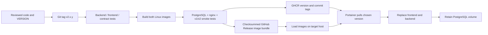

# Versioned releases and simple Portainer updates

The v2 deployment uses **prebuilt release images**, instead of building images in Portainer. Both application images share one immutable version, selected by `TOI_RELEASE_TAG`. PostgreSQL and its named volume are separate from application releases.

[Release v2.0.1 is published](https://github.com/monty23monty/MKLTV-TOI-V1/releases/tag/v2.0.1), with anonymous pulls verified for both GHCR images. No registry login or package-visibility change is needed for this release. The public image bundle was independently downloaded and its checksums verified as well.

Use [compose.release.yaml](compose.release.yaml) for this workflow. [compose.portainer.yaml](compose.portainer.yaml) remains available for locally built images; its `TOI_IMAGE_TAG` variable is a different setting. These instructions target **Linux amd64, Docker Standalone and Docker Compose v2**. The first release does not publish ARM64 images.

## Architecture



Publication happens only after tests and stack checks pass. Version and full commit labels identify both images. No floating `latest` tag, unattended updater or update webhook changes an application during a live match. Updating briefly interrupts API/WebSocket connections; pause the game clock and update between sessions. Clients reconnect using their saved stream cursor.

The release workflow publishes these exact names:

```text
ghcr.io/monty23monty/mkltv-toi-backend:v2.0.1
ghcr.io/monty23monty/mkltv-toi-frontend:v2.0.1
```

Later releases use their own version tags and `sha-FULL-COMMIT` tags. Existing version tags are not overwritten by the pipeline. A successful GitHub Release includes `release-manifest.json`, image IDs, the Git commit, checksums, stack files and a Docker image bundle. The manifest states whether registry publishing and **anonymous image pulls were actually verified**. A private GHCR package is not described as publicly pullable merely because the source repository is public.

## One-time upgrade of the existing `toi-v1` stack

### 1. Pause and back up

Pause tracking on the operator screen. Save the current stack YAML, environment values, image tags and actual volume name. Keep secrets outside the repository.

On the target Linux Docker host, create and check a logical backup. The container name below matches the existing `toi-v1` stack; use its actual database container name if different:

```bash
umask 077
docker exec toi-v1-db-1 sh -c 'pg_dump -U "$POSTGRES_USER" -d "$POSTGRES_DB" -Fc' > toi-before-v2.dump
docker exec -i toi-v1-db-1 pg_restore --list < toi-before-v2.dump > /dev/null
```

Keep a copy on another machine. A backup of Portainer's configuration does not contain the PostgreSQL application data.

### 2. Check release image availability

Open the repository's [Releases](https://github.com/monty23monty/MKLTV-TOI-V1/releases) and choose the intended published version. Read its release notes, including database compatibility. Download `release-manifest.json` if needed.

If **anonymous GHCR pulls were verified**, Portainer can pull the images directly. No Portainer image builds or manual image tagging are required.

If the manifest says anonymous pulls are unavailable, use either of these paths:

- The repository owner makes both packages public once: GitHub profile → **Packages** → `mkltv-toi-backend` / `mkltv-toi-frontend` → **Package settings** → **Change visibility → Public**. Verify both pulls below without registry credentials before relying on anonymous deployment. GitHub makes newly published container packages private by default, independently of repository visibility ([GitHub registry documentation](https://docs.github.com/en/packages/working-with-a-github-packages-registry/working-with-the-container-registry)).
- Load the public release bundle on the target Docker host using the [archive method](#registry-independent-image-loading). This avoids GitHub registry credentials entirely and retains the same image names and tags.

Anonymous checks on a Linux machine with Docker (a temporary Docker config avoids using saved credentials):

```bash
mkdir -p /tmp/toi-anonymous-docker
docker --config /tmp/toi-anonymous-docker pull ghcr.io/monty23monty/mkltv-toi-backend:v2.0.1
docker --config /tmp/toi-anonymous-docker pull ghcr.io/monty23monty/mkltv-toi-frontend:v2.0.1
```

Portainer can alternatively use a GHCR registry entry with a classic GitHub token restricted to `read:packages`. Do not enter your operator token or database password as a registry password. The public package or archive approach avoids needing a registry credential on the server.

### 3. Replace the existing stack definition

In Portainer, select the same Docker environment and **Stacks → toi-v1 → Editor**. Replace the YAML with the published release's `compose.release.yaml`.

**Keep the stack name `toi-v1`.** The service names `db`, `backend`, `frontend` and volume key `postgres_data` are intentionally retained, so the existing `toi-v1_postgres_data` volume remains attached. Do not create a second stack or delete the existing volume. If you used a different stack name, retain that name instead.

Set or retain these stack environment variables:

| Variable | Setting |
| --- | --- |
| `TOI_RELEASE_TAG` | `v2.0.1`, or the exact published version selected |
| `POSTGRES_DB`, `POSTGRES_USER`, `POSTGRES_PASSWORD` | Keep the existing values |
| `TOI_AUTH_TOKEN`, `TOI_OPERATOR_TOKENS` | Keep existing operator credentials |
| `TOI_CORS_ORIGINS` | Keep the exact iPad dashboard origin, including scheme and port |
| `TOI_FRONTEND_PORT`, `TOI_BIND_ADDRESS` | Keep the existing port/address |
| `TOI_STREAM_ENABLED` | `true` |
| `TOI_SERVICE_TOKENS` | Configure dedicated clock/reader permissions as described in [SERVICE_INTERFACE.md](SERVICE_INTERFACE.md); empty disables v2 service access, without affecting v1 operator access |
| `TOI_PULL_POLICY` | `missing` for registry pulls; `never` after loading the archive |

The old `TOI_IMAGE_TAG=portainer-v1` is no longer used by this release stack. A full template is provided in [release.env.example](release.env.example). Leave `TOI_IMAGE_REGISTRY` at its default `ghcr.io/monty23monty` unless using your own registry.

On the first start with streaming enabled, **all saved games are activated**, even if no service tokens are configured yet. Existing external clocks pause at their saved cutoff and require a configured v2 bridge plus explicit handover in the operator clock dialog. Manual controls remain available. Stop an old v1 clock bridge before deploying: activated games reject its unfenced observations. Disabling `TOI_STREAM_ENABLED` later does not remove the persisted fence; it is not a rollback procedure.

For registry deployment, enable **Re-pull image** when updating. For archive deployment, disable **Re-pull image** and set `TOI_PULL_POLICY=never` so Portainer uses the loaded images. Click **Update the stack**. Keep the PostgreSQL image on major version 17 and keep its credentials unchanged; initialization variables do not rotate an existing database password.

### 4. Verify before resuming

- `db`, `backend` and `frontend` become healthy.
- Open `http://YOUR-SERVER-IP:8080/health` (or your configured dashboard origin); check the reported version/revision matches the selected release.
- Refresh the iPad and confirm the existing match, lineups, TOI and history are present.
- Connect a service client, read a snapshot and reconnect using its cursor; on a training match, check a command acknowledgement and corresponding recorded event.
- Resume tracking only after these checks succeed.

The backend applies database migrations before it starts serving. One API worker/replica remains deliberate: notifications use the application's in-process hub. Do not scale replicas behind a load balancer without shared pub/sub and distributed write ownership.

## Every later application update

1. Read the release notes, pause tracking and take a checked database backup.
2. In **Stacks → toi-v1 → Editor**, change **only** `TOI_RELEASE_TAG` to the selected published version, for example `v2.0.2`.
3. Registry mode: **Update the stack** with **Re-pull image** enabled. Archive mode: load the new bundle first, retain `TOI_PULL_POLICY=never`, and update with re-pulling disabled.
4. Wait for health checks, verify the reported version and resumed match, then resume tracking.

There is no need to build, find intermediate images, or add tags in Portainer. Updating the source Git branch alone does not change a pinned production stack. When release notes require a stack/configuration change, copy that release's stack file and retain the existing environment values and volume.

## Registry-independent image loading

Every successfully published release also includes `mkltoi-v2.0.1-linux-amd64.tar.gz` and `SHA256SUMS`. These contain both **final runtime images with their tags**, not source code or intermediate Node stages. Docker's [image save](https://docs.docker.com/reference/cli/docker/image/save/) and [image load](https://docs.docker.com/reference/cli/docker/image/load/) preserve the names, tags, labels and runtime configuration.

Download the release's `load-release-images.sh` asset and run it **on the same Docker host/environment Portainer manages**:

```bash
sh load-release-images.sh v2.0.1
```

The script downloads the public bundle and checksums, verifies SHA-256 before loading, checks both embedded version labels, and never edits a running stack or database. It requires Linux amd64, Docker, curl and GNU sha256sum. You can also download the archive and checksums manually and run:

```bash
sha256sum --check --ignore-missing SHA256SUMS
docker image load --input mkltoi-v2.0.1-linux-amd64.tar.gz
```

Set `TOI_PULL_POLICY=never`, select the matching `TOI_RELEASE_TAG`, and leave Portainer's re-pull option disabled. The only image that may still need a registry pull is PostgreSQL if it is not already cached.

## Docker Compose CLI alternative

For a deployment managed by the CLI, download the published Compose file and environment template into a protected directory, copy `release.env.example` to `.env.release`, and enter the existing secrets. Keep the same project name used by the existing stack:

```bash
chmod 600 .env.release
docker compose --env-file .env.release -p toi-v1 -f compose.release.yaml config --quiet
docker compose --env-file .env.release -p toi-v1 -f compose.release.yaml pull backend frontend
docker compose --env-file .env.release -p toi-v1 -f compose.release.yaml up -d --wait --wait-timeout 180
```

Skip `pull` and retain `TOI_PULL_POLICY=never` when using loaded image archives. Do not alternate CLI and Portainer editing of the same stack; choose the tool that owns its configuration.

## Recovery and rollback

Release 2.0.1 adds migration `0003` and persisted clock-ownership/journal metadata. A return to a pre-v2 application image requires the checked pre-upgrade database backup; this release does not certify running an old writer against an activated v2 timeline. Prefer a subsequent v2 patch release for an application fix. Never manually drop journal tables or remove ownership metadata to bypass a fence.

If an upgrade fails, leave tracking paused. Check backend migration/database logs and frontend nginx logs. A failing new container does not erase the named volume. Avoid repeatedly changing credentials or recreating the stack under a new name.

For an application rollback, set the prior published `TOI_RELEASE_TAG` and update the stack. The backend and frontend must use the same release. Do this only when the release notes say the existing database schema remains compatible. Database migrations are not automatically reversed by selecting an old image.

For a migration that is incompatible with the older version, stop backend and frontend, keep the database running, and restore the matching pre-upgrade backup as described in [PORTAINER.md](PORTAINER.md#back-up-and-restore-match-data), then select both previous images. Restoring discards changes made after that backup. Keep the database container on PostgreSQL 17; changing its major version against the existing data directory is not a PostgreSQL downgrade procedure.

When restoring a v2 database, run the documented offline `python -m toi.admin rotate-journals --all --confirm-offline` operation before restarting any API worker. It prevents service checkpoints and clock fencing generations from referring to a divergent restored timeline. The maintenance flag is an explicit assertion that workers are stopped, not a process detector; use the one-off container procedure in the backup guide.

## Publishing future releases

Maintainers update `VERSION`, the backend's development version and relevant release notes, run the checks, commit, then push a matching Git tag, for example `v2.0.2`. The [release workflow](.github/workflows/release.yml) checks the tag/version match, runs backend/frontend/contract tests, builds the two images, exercises v1/v2 through nginx with PostgreSQL and checks persistence across recreation. Only then does it publish version/commit tags and a GitHub Release. Manual workflow dispatch validates the selected revision without publishing it.

The workflow needs repository `contents: write` and `packages: write` using the scoped `GITHUB_TOKEN`; no registry token is baked into an image. The first publication may require the one-time package visibility change above. A failed registry publication is recorded in the manifest, and the verified public archive remains available. Release archives are loaded again in CI and checked for the exact source revision before being published. Tags/releases are treated as immutable: publish a new version rather than replacing an existing one.

Release automation publishes artifacts; it does not call the user's Portainer instance, update production, change live clock ownership or delete production volumes.
